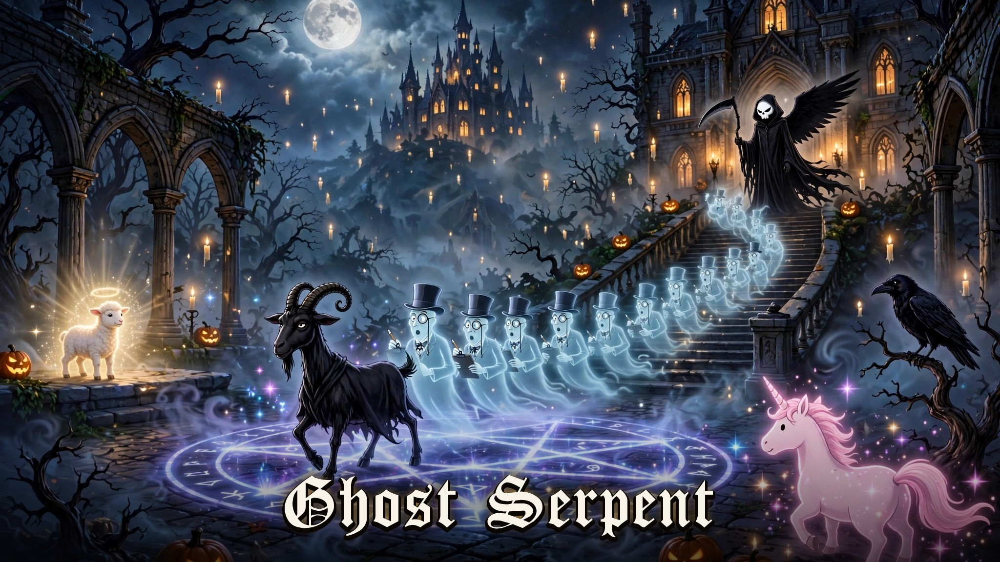
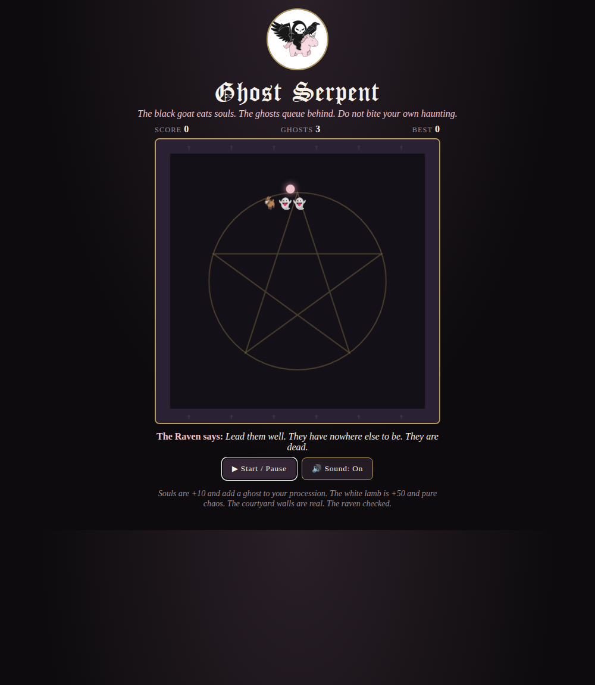

# 🐐 Ghost Serpent

**The black goat eats souls. The ghosts queue behind. Do not bite your own haunting.**

A snake game inside a pentagram courtyard, from the gothic world of **Grin Reaper**. Every soul the goat eats joins the procession as a ghost — which is lovely, until the procession is long enough to eat itself.

## ▶ Play it live

**[Play Ghost Serpent](https://itsgrinreaper.github.io/ghost-serpent/)** — free, in your browser.

## 📸 Preview

## How to play

- **Move:** Arrow keys / WASD, swipe, or the on-screen buttons
- **Souls** are +10 and add one ghost to your tail
- **The white lamb** appears briefly: +50, pure chaos, nobody knows why it was in the pentagram
- The walls are real. Your own ghosts are real. The raven checked

*The Raven supervises. The pentagram is decorative. Probably.*
